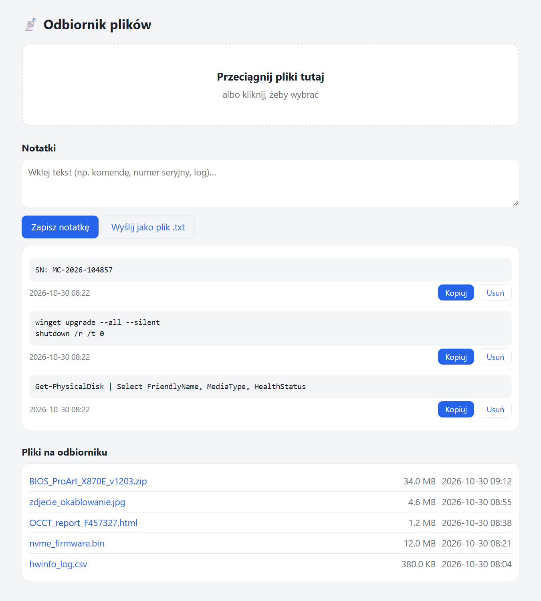
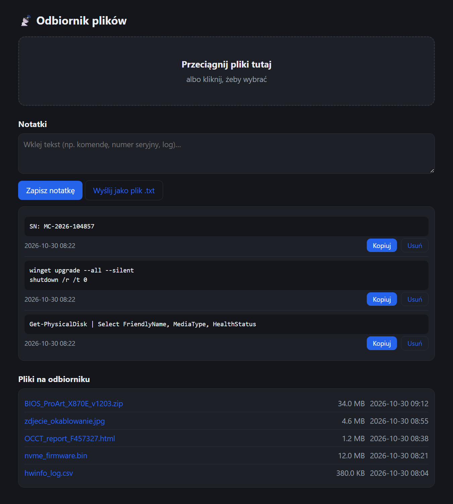

# 📡 mdrop
Zero-install LAN file drop and shared notes for Windows.

Built for a PC assembly and production floor where technicians needed to move BIOS files, logs, test reports, and commands between production machines and workstations without using USB sticks, network shares, or installing any software.

The whole thing is two files and pure Windows PowerShell 5.1 + .NET that ships with Windows: no installer, no Node, no Python, no dependencies. `Odbiornik.bat` is the launcher (self-elevates to admin), `Odbiornik.ps1` is the server with the HTML/CSS/JS UI embedded.

### Screenshots
| Light theme | Dark theme |
| :--- | :--- |
|  |  |

### Features
* **Drag & Drop Uploads:** Multiple files with per-file progress bars. Files are streamed via a 1 MB buffer and written to `.part` files first to prevent half-finished uploads from appearing.
* **Smart File Handling:** Duplicate names are automatically renamed (e.g., `file (1).zip`). Filenames are sanitized to neutralize path traversal attempts.
* **Bidirectional File List:** View and download files from the receiver's folder; the list refreshes every 3 seconds.
* **Shared Notes:** Paste text (commands, serial numbers, logs) to sync it across all connected browsers. Includes "Copy" and "Delete" buttons. Notes persist in `%APPDATA%\Odbiornik\notatki.json`.
* **Note Utilities:** "Send as .txt" button converts pasted text into a timestamped `.txt` file.
* **Robust Clipboard:** The "Copy" button uses a fallback from `navigator.clipboard` to `document.execCommand('copy')` to ensure it works on plain HTTP.
* **Adaptive UI:** Light and dark themes follow the OS `prefers-color-scheme`. Note: The UI is in Polish.

### How http://mdrop works
The script includes a built-in name responder running in a background runspace. It answers LLMNR queries (UDP 5355, multicast 224.0.0.252) for the single-label name `mdrop` and mDNS queries (UDP 5353, multicast 224.0.0.251) for `mdrop.local`. It replies with the IP of the network interface facing the requesting machine. This eliminates the need for DNS servers, router configuration, or hosts files. The name disappears from the network as soon as the receiver is closed.

### Usage
1. Place `Odbiornik.bat` and `Odbiornik.ps1` in the same folder.
2. Double-click `Odbiornik.bat` and accept the Windows admin prompt.
3. On any other PC on the same network, open `http://mdrop` in a browser (type `mdrop/` or the full `http://` URL to prevent search engine redirects).
4. Close the console window to stop the server.

### Configuration
Parameters are located at the top of `Odbiornik.ps1`:
* `-Name`: Default is `mdrop`.
* `-Port`: Default is `80`.
* `-FallbackPort`: Default is `8765`.
* **Receive Folder:** Files land in `Desktop\Odebrane`.

The server uses `http.sys` via `System.Net.HttpListener` on port 80. If port 80 is occupied, it falls back to port 8765. On first run, it automatically adds Windows Firewall rules for TCP 80/8765 and UDP 5353/5355.

### API Endpoints
| Endpoint | Method | Description |
| :--- | :--- | :--- |
| `/` | GET | Web UI |
| `/list` | GET | JSON file list |
| `/upload?name=` | POST | Raw file upload |
| `/file?name=` | GET | File download |
| `/notes` | GET | Get shared notes |
| `/notes` | POST | Save note (raw UTF-8 text) |
| `/notes/delete?id=` | POST | Delete a note |

### Requirements
* Windows 10 or 11.
* Windows PowerShell 5.1 (built-in).
* Administrator rights on the receiver PC.

### Security Note
**Intended for trusted LAN environments only.** There is no authentication or encryption. Anyone on the network who can reach the receiver can upload, download, and read all notes. Do not leave it running permanently or on untrusted or public networks.

Author: Michal Pytel
